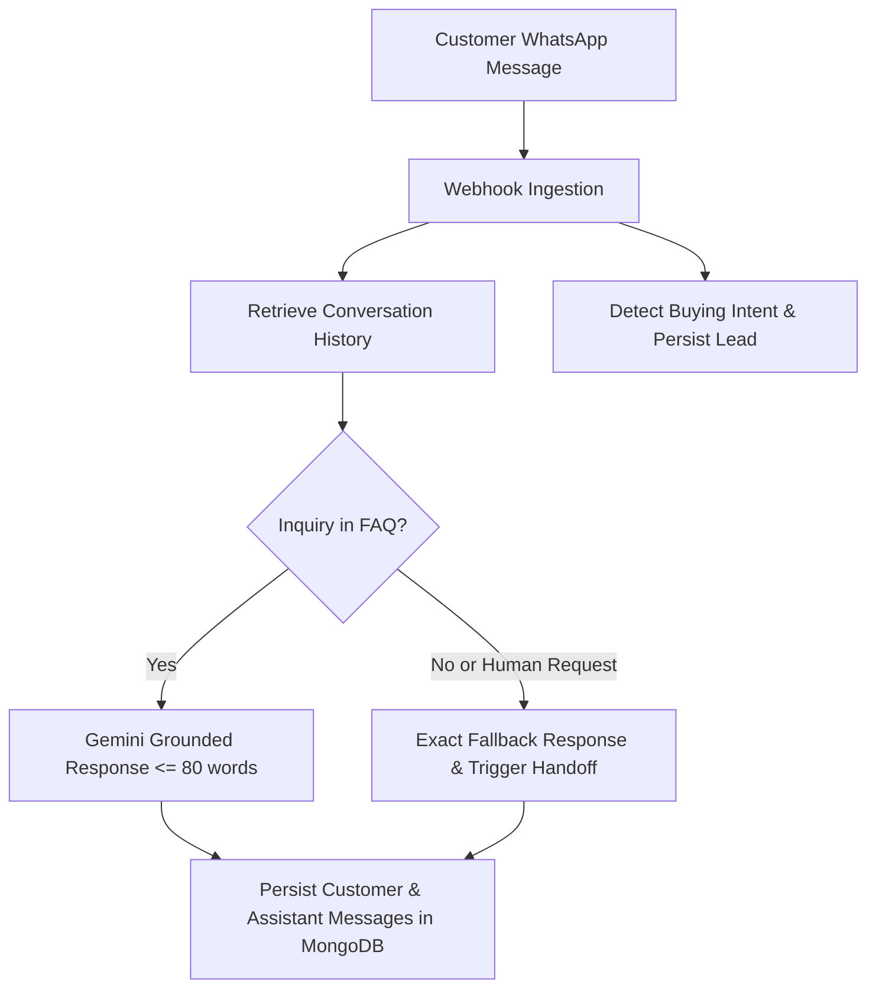

# Reliable Paper Mart AI Assistant

An AI-powered customer support backend for **Reliable Paper Mart**, a B2B paper merchant with 50+ years of industry experience. The assistant automates customer inquiries over WhatsApp, answers product questions using grounded company data, captures leads, and escalates complex requests to human agents.

---

## 1. Project Overview

The Reliable Paper Mart AI Assistant acts as an intelligent WhatsApp representative for B2B paper buyers, printers, and packaging manufacturers across India.

### Key Features
- **Gemini AI Grounding:** Generates concise, accurate responses (under 80 words) using Google Gemini (`gemini-3.5-flash-lite`), grounded strictly in company FAQ data without hallucinations.
- **FAQ-Based Responses:** Answers inquiries across 5 major paper grades: Writing & Printing, Packaging, Speciality, Industrial, and Sustainable/Handmade paper.
- **Conversation Memory:** Preserves multi-turn context (sliding window of 10 messages) in MongoDB to resolve pronouns and follow-up questions.
- **Lead Capture:** Automatically detects commercial buying intent and captures customer name, phone number, and product requirements.
- **Human Handoff:** Instantly escalates unsupported queries or explicit agent requests with the exact message: `Let me connect you with our team member.`

---

## 2. Tech Stack

- **Runtime:** Node.js (v18+, ES Modules)
- **Framework:** Express.js 5
- **Database:** MongoDB with Mongoose 9
- **AI / LLM:** Google Gemini API via official `@google/genai` SDK
- **Utilities:** `dotenv`, `cors`, `nodemon`

---

## 3. Project Structure

```text
papermart/
├── docs/                # Project audits, reports, and submission checks
├── src/
│   ├── config/          # Environment variables and MongoDB connection
│   ├── controllers/     # Route handlers (health, webhook, leads, handoffs)
│   ├── data/            # Grounded FAQ knowledge base (faq.js)
│   ├── middleware/      # Error handler and 404 middleware
│   ├── models/          # Mongoose schemas (Conversation, Lead)
│   ├── routes/          # Express route definitions
│   ├── services/        # Business logic (Gemini, Webhook, Lead, Handoff)
│   ├── app.js           # Express app setup and middleware
│   └── server.js        # Server startup and MongoDB initialization
├── tests/               # Automated test suites and master runner
├── .env.example         # Environment variables template
└── package.json         # Dependencies and scripts
```

---

## 4. Prerequisites

- **Node.js:** v18.x or later
- **npm:** v9.x or later
- **MongoDB:** Active connection URI (MongoDB Atlas or local instance)
- **Google Gemini API Key:** Valid key from [Google AI Studio](https://aistudio.google.com/)

---

## 5. Installation and Setup

### 1. Clone the repository and install dependencies
```bash
git clone YOUR_REPOSITORY_URL
cd papermart
npm install
```

### 2. Configure environment variables
Create your local `.env` file from the provided template:

**Windows PowerShell:**
```powershell
Copy-Item .env.example .env
```

**macOS / Linux:**
```bash
cp .env.example .env
```

### 3. Set your credentials in `.env`
Open `.env` and fill in your values:

```env
PORT=5000
MONGODB_URI=mongodb+srv://<username>:<password>@<cluster-host>/<database>?retryWrites=true&w=majority
GEMINI_API_KEY=your_gemini_api_key_here
GEMINI_MODEL=gemini-3.5-flash-lite
WHATSAPP_VERIFY_TOKEN=your_whatsapp_verify_token_here
CONVERSATION_HISTORY_LIMIT=10
NODE_ENV=development
```

> [!IMPORTANT]
> Never commit your `.env` file or real API keys to version control.

---

## 6. Run the Project

### Development mode (with hot-reload)
```bash
npm run dev
```

### Production mode
```bash
npm start
```

- **Local Server URL:** `http://localhost:5000`
- **Health Check Endpoint:** `http://localhost:5000/health`

---

## 7. API Testing with Postman

### Endpoints Summary

| Method | Endpoint | Purpose |
| :--- | :--- | :--- |
| `GET` | `/health` | Check server status |
| `GET` | `/webhook` | Verify webhook token with Meta challenge |
| `POST` | `/webhook/simulate` | Simulate a WhatsApp customer message and test AI response |
| `GET` | `/leads` | View captured customer leads |
| `GET` | `/handoffs` | View human handoff requests (`?status=pending` or `?status=resolved`) |
| `PATCH` | `/handoffs/:phoneNumber/resolve` | Resolve a pending human handoff |

### Testing Instructions

1. **Test `GET /health`:**
   Send request to `http://localhost:5000/health`. Confirms server is running with HTTP 200 `{ "success": true }`.
2. **Test `GET /webhook`:**
   Add query params `hub.mode=subscribe`, `hub.verify_token=your_whatsapp_verify_token_here`, and `hub.challenge=1158201444`. The endpoint will return `1158201444` with HTTP 200.
3. **Test `POST /webhook/simulate`:**
   Send a sample WhatsApp payload (see below).
4. **Test Grounded FAQ & Fallback:**
   - Ask: `"Do you supply copier paper?"` → Returns grounded answer under 80 words.
   - Ask: `"Do you sell laptops?"` → Returns exact fallback: `Let me connect you with our team member.`
5. **Test Lead Capture:**
   Send a message showing purchase intent (e.g., `"Need 500 reams A4 copier paper, Rahul"`). Then call `GET /leads` to see the captured lead record.
6. **Test Human Handoff:**
   Send `"I want to talk to an agent"`. Check `GET /handoffs?status=pending`. Mark resolved via `PATCH /handoffs/919876543210/resolve`.

### Sample Request for `POST /webhook/simulate`

```json
{
  "object": "whatsapp_business_account",
  "entry": [
    {
      "id": "BIZ_SIMULATED",
      "changes": [
        {
          "value": {
            "messaging_product": "whatsapp",
            "metadata": {
              "display_phone_number": "15550000000",
              "phone_number_id": "PHONE_SIMULATED"
            },
            "contacts": [
              {
                "profile": { "name": "Rahul Sharma" },
                "wa_id": "919876543210"
              }
            ],
            "messages": [
              {
                "from": "919876543210",
                "id": "wamid.sim_12345",
                "timestamp": "1700000000",
                "type": "text",
                "text": {
                  "body": "Hi, do you provide 80 GSM maplitho paper in reels?"
                }
              }
            ]
          },
          "field": "messages"
        }
      ]
    }
  ]
}
```

*(Alternatively, `/webhook/simulate` also accepts a simplified format: `{"phoneNumber": "919876543210", "content": "Do you provide Kraft paper?", "customerName": "Rahul Sharma"}`)*

---

## 8. Application Workflow



### Processing Steps
1. Customer sends a WhatsApp-compatible message.
2. Backend receives and processes the webhook payload (`POST /webhook` or `/webhook/simulate`).
3. Prior conversation history is retrieved from MongoDB (`Conversation` model).
4. Lead information (buyer intent, product name, quantities) is detected and saved to MongoDB (`Lead` model).
5. Relevant official FAQ information is retrieved from `src/data/faq.js`.
6. Gemini generates a concise, strictly grounded response based only on the FAQ.
7. Unsupported questions or out-of-scope inquiries receive the exact fallback: `Let me connect you with our team member.`
8. Human handoff is triggered for unsupported inquiries or when the customer explicitly asks for human assistance (`needsHuman: true`).
9. Customer and assistant messages are saved to the customer's MongoDB conversation thread.

---

## 9. Run Automated Tests

Execute the master test runner:

```bash
npm test
```

### Test Coverage
The automated test suite runs 8 sequential test phases covering:
- **Phase 3:** WhatsApp Webhook parsing, payload validation, duplicate message handling, and event acknowledgments.
- **Phase 4:** Gemini AI prompt grounding, negative constraint enforcement, and 80-word boundary validation.
- **Phase 5:** Multi-turn conversation memory, sliding window management, and pronoun resolution across turns.
- **Phase 6:** Customer lead detection, entity extraction, and deduplication.
- **Phase 7:** Human handoff trigger conditions, handoff list queries, and resolution state transitions.
- **Phase 8:** Complete end-to-end customer journey testing and Webhook + Gemini AI integration.
- **FAQ Expansion:** Website intelligence verification across 64 curated FAQ topics.

*Current Test Status: 8 of 8 suites passing (100% success rate).*

---

## 10. Environment and Security Notes

- **Private `.env`:** The `.env` file contains sensitive API keys and database credentials and is strictly excluded from version control via `.gitignore`.
- **Template Only:** `.env.example` contains only non-sensitive dummy placeholders.
- **Simulated Testing:** A live Meta WhatsApp Business account is not required for local development; `POST /webhook/simulate` processes messages with identical payload logic.
- **Outbound WhatsApp Delivery:** Actual outbound WhatsApp message delivery via Meta Graph API is not implemented; assistant replies are returned in the HTTP response and stored in MongoDB.
- **Demo Endpoints:** `/leads` and `/handoffs` are currently unauthenticated demonstration endpoints. In a production deployment, secure these routes with authentication and role-based access control (e.g., JWT or API key middleware).

